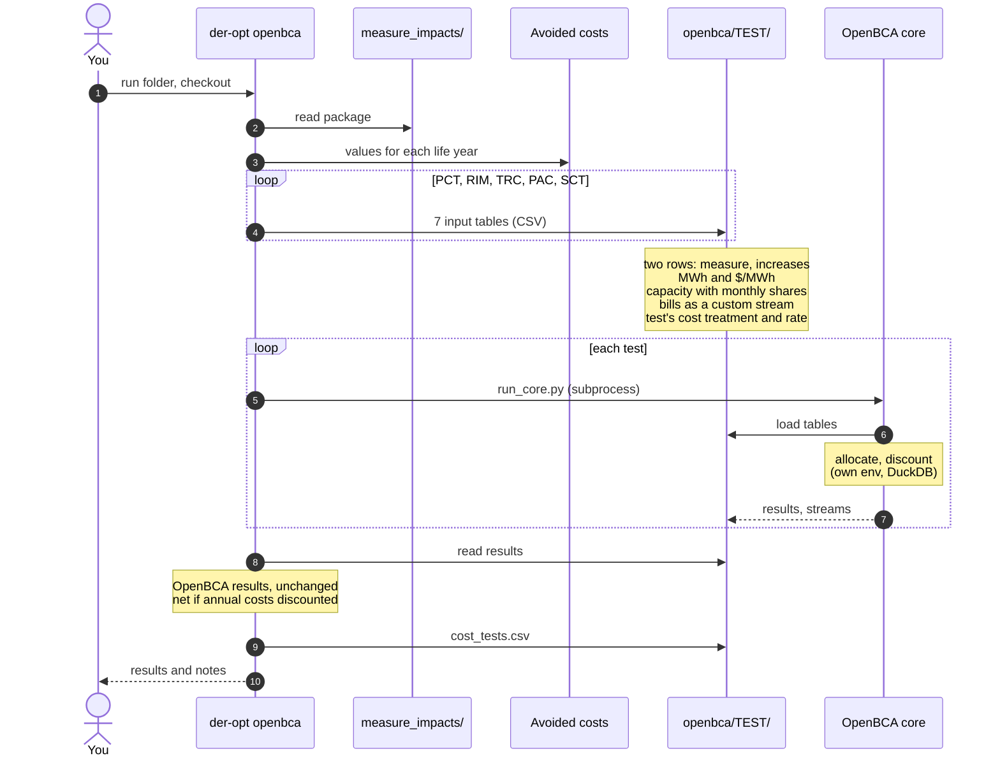

# How a full-year measure analysis runs

Two commands take a measure from a scenario file to cost-test results:

```bash
der-opt run scenario.yaml -o out/measure          # a scenario with `dr` and `cost_test` sections
der-opt openbca out/measure                       # or: der-opt run ... --cost-tests
```

The diagrams show which run produces which number, and in what order. Order matters
in three places, marked ①–③:

1. **The expected settlement baseline** comes from R2, the non-responding twin,
   *before* the responding run is solved; that's what the optimizer is paid against.
   The **reported** settlement is recomputed *after*, from the responding run's own
   history.
2. **Shadow events** (counted capacity) each start from R2's device state that
   morning, and never change the annual runs.
3. **Screening values and the impact package** compare the responding run with R1 or
   R3, depending on `cost_test.scope`.

Specs: [scenario building blocks](SCENARIO_COMPOSITION_SPEC.md), [input data](INPUT_DATA_SPEC.md), [DR events and capacity](DR_CAPACITY_SPEC.md),
[avoided costs](AVOIDED_COST_SPEC.md), [cost tests](COST_TEST_SPEC.md), [comparison cases](COMPARISON_CASES_SPEC.md).

## 1. `der-opt run`: the measure's year, DR study, screening values, impact package

```mermaid
sequenceDiagram
    autonumber
    actor U as You
    participant CLI as der-opt run
    participant L as Loader
    participant O as Optimizer
    participant S as Simulator
    participant DR as DR study
    participant AC as Avoided costs
    participant F as Output (-o)

    U->>CLI: scenario.yaml
    CLI->>L: compose, validate
    L-->>CLI: premise
    Note over L: extends merged, paths resolved<br/>no-solve checks: errors stop here

    rect rgba(120, 120, 120, 0.08)
    CLI->>O: solve year, no events
    O-->>CLI: R2 (non-responding twin)
    CLI->>S: rule-based policies
    S-->>CLI: R1 (counterfactual)
    Note over CLI: bill R2 and R1<br/>(billing section)
    end

    rect rgba(120, 120, 120, 0.08)
    CLI->>DR: config, R2
    Note over DR: event calendar(s):<br/>file, price, random or schedule<br/>rule breaks stop the run
    DR->>S: R1 again
    DR->>O: solve without measure
    O-->>DR: R3 (no measure)
    loop each calendar
        Note over DR: ① expected S from R2
        DR->>O: solve with response
        O-->>DR: responding run
        Note over DR: settlement S from its own<br/>history (net, import)<br/>per event vs R1, R2, R3, S
    end
    loop ② each eligible day
        DR->>O: one-day solve from R2 state
        O-->>DR: shadow event
    end
    Note over DR: capacity by month<br/>counted and accounted<br/>Slice-of-Day, DR checks
    DR-->>CLI: DR study
    end

    Note over CLI: comparison cases: no devices (metered load),<br/>no measure (R3, or a solve),<br/>rule-based (R1), optimized (R2),<br/>responding; each priced and billed

    rect rgba(120, 120, 120, 0.08)
    CLI->>AC: read, validate set
    Note over CLI: ③ without = R1 (control)<br/>or R3 (device)<br/>with = responding run
    AC-->>CLI: screening values
    end

    Note over CLI: checks on every run
    CLI->>F: CSVs, charts, dr_*.csv, cases*.csv
    CLI->>F: measure_impacts/
    CLI->>F: run_record.json
    CLI-->>U: summary and checks
```

## 2. `der-opt openbca`: cost tests in OpenBCA

der-opt computes no cost tests. It writes OpenBCA's input tables, runs OpenBCA's own
core in OpenBCA's own Python environment, and reads back OpenBCA's results.


